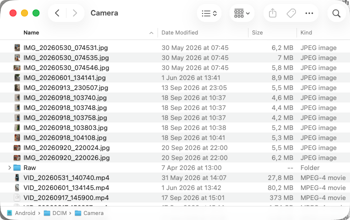
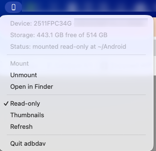

<h1 align="center">adbdav</h1>

<p align="center">
  <b>Mount an Android phone on macOS as an ordinary Finder volume — over <code>adb</code>, with no kernel extension and no reboot.</b>
</p>

<p align="center">
  
</p>

<p align="center"><i>The phone's camera folder, as an ordinary Finder volume. Nothing is copied to the Mac until you open a file.</i></p>

```
Finder ──webdav──> 127.0.0.1 (adbdav) ──adb──> device /sdcard
```

---

## The problem

You plug an Android phone into a Mac and there is no supported way to see its files.

- **MTP does not exist on macOS.** There is no built-in support, Google's *Android File
  Transfer* was discontinued, and on current vendor ROMs the MTP USB mode can be switched on and
  then silently reverted by the system within seconds. This route can simply be unavailable to
  you, with nothing to fix.
- **macFUSE works, but it is a kernel extension.** On Apple Silicon, loading a third-party kext
  means booting into Recovery and dropping to *Reduced Security*. If the machine is doing
  anything — a database, a build, containers that are expensive to stop — "just reboot twice"
  is not a small ask. On a managed Mac it may not be permitted at all.
- **Cloud and companion apps** need an app installed on the phone, an account, and a round trip
  through someone else's server to move a file between two devices on the same desk.

Meanwhile `adb` is right there, already authorised, already moving bytes.

## The solution

macOS ships a **WebDAV client in the base system** — `/sbin/mount_webdav`. It is userspace, it
needs no extension, and it needs no reboot.

So `adbdav` serves the phone as a WebDAV filesystem on loopback and hands that URL to macOS.
What you get is a normal volume: open it in Finder, drag files out of it, `ls` it, `rsync` from
it, point any application at it.

- **No macFUSE**, no Recovery boot, no Reduced Security, no kext at all.
- **No MTP**, so there is no USB-mode dance for the ROM to undo.
- **No app on the phone** — only USB debugging, which you already enabled to use `adb`.
- **Read-only by default**, enforced by the kernel as well as the server.

<p align="center">
  
</p>

<p align="center"><i>The menu bar app: device, free space, mount state, and the whole lifecycle.</i></p>

## Install

Needs Go 1.24+, the Xcode command line tools (cgo, for the menu bar), and `adb` on `PATH`.

```sh
make install          # builds ./adbdav and installs it into $PREFIX/bin (default /opt/homebrew)
make app              # builds Adbdav.app, the menu bar front end
make check            # gofmt + vet + tests — no phone needed
```

## Use

```sh
adbdav status                 # adb, attached devices, free space, mount state
adbdav mount                  # mount at ~/Android; Ctrl-C unmounts
adbdav mount -at /Volumes/Pixel -name Pixel
adbdav mount -write           # allow writing (read-only otherwise)
adbdav serve                  # just the WebDAV server; mount it yourself
adbdav unmount                # clean up a mount left behind
adbdav menubar                # menu bar app (the default inside Adbdav.app)
```

| Flag | Default | Meaning |
|---|---|---|
| `-at` | `~/Android` | mount point |
| `-root` | `/sdcard` | device path exposed as the filesystem root |
| `-serial` | the only device | which device, when several are attached |
| `-name` | `Android` | volume name in Finder |
| `-port` | `0` | loopback port; 0 picks a free one |
| `-cache` | `5000` | metadata cache TTL in ms; `0` really does disable it |
| `-write` | off | **allow writing — the default mount is read-only** |
| `-no-verify` | off | skip re-hashing each upload on the device |
| `-thumbnails` | off | let Quick Look build previews (reads every image in full) |
| `-keep-apple-junk` | off | write Finder's `.DS_Store` and `._` sidecars to the device |
| `-auto` | off | menubar: mount as soon as the app starts |
| `-v` | off | log every WebDAV request |

The menu bar app shows the device model and serial, free space and mount state, and mounts,
unmounts, reveals the volume in Finder, and toggles read-only and thumbnails. (Turning
read-only off remounts: that flag is held by the kernel, not by the server.)

## Performance

Reproduce all of it with `./bench/bench.sh` — it is read-only, and it asserts every response
code before it times anything, because a benchmark that does not will cheerfully report a failed
request as sub-millisecond speed.

<!--BENCH-->

| Operation | Measured | Reference |
|---|---|---|
| **Listing a 76-entry directory** — on the device itself (`find` + `stat` over `adb`) | 0.142s | the floor |
| &nbsp;&nbsp;↳ PROPFIND `Depth: 1`, cold (fresh server, nothing cached) | 1.253s | |
| &nbsp;&nbsp;↳ PROPFIND `Depth: 1`, warm | 0.001s | |
| &nbsp;&nbsp;↳ PROPFIND `Depth: 1`, **`-cache 0`** — one `adb` round trip per entry | 18.070s | what a naive bridge costs |
| **Single `stat`** — PROPFIND `Depth: 0`, uncached | 0.387s | one `adb` round trip |
| **Read 77 MB** — HTTP GET through the mount | 6.600s (11.6 MB/s) | `adb exec-out cat`: 11.8 MB/s |
| &nbsp;&nbsp;↳ first 1 MiB only — ranged GET | 0.208s | |
| **Hash 77 MB on the device** — `sha256sum` for write verification | 0.177s | nothing transferred |

Device: 2511FPC34G. 5 runs each, median. Reads are of a 77 MB file.
Reproduce with `./bench/bench.sh`.

<!--/BENCH-->

Two things are worth reading out of that table.

**The WebDAV layer is not the cost; `adb` is.** A directory listing served from cache is ~1 ms,
and a full-file read runs at essentially the same MB/s as `adb exec-out cat` of the same file.
There is no meaningful overhead left to remove in the bridge — which is only true because the
round trips below were found and eliminated.

**Latency, not throughput, is what makes a phone feel slow in Finder.** A single `adb` round
trip costs hundreds of milliseconds, so a design that performs one per file turns one ordinary
folder into a half-minute stall. Every optimisation here is the removal of one such per-file
round trip — and the `-cache 0` row is what the same code costs with those removals switched
off.

Concurrency is covered separately by `./bench/stress.sh`, which drives four clients at once:
four simultaneous 77 MB reads complete in ~18 s each, with no stalled or failed requests.

### What a naive bridge gets wrong

Each of these was measured, and each is now pinned by a test.

- ⛔ **`webdav.walkFS` re-`Stat`s every child after `Readdir`.** A 76-entry directory therefore
  costs 76 extra `adb` round trips — a PROPFIND of **5.81 s** when the device answers the same
  question in 0.06 s. A listing now primes each child's entry in the stat cache, so those
  `Stat`s are hits. That is the whole distance between the `-cache 0` row of the table above and
  the two rows beneath it: **tens of seconds down to ~1.6 s cold and ~1 ms warm**.
- ⛔ **webdav answers `getcontenttype` by opening the file and reading 512 bytes** whenever the
  extension is unknown — again one round trip per file. 60 extension-less files cost **3.51 s**
  per PROPFIND. Implementing webdav's `ContentType` hook lets the extension answer instead:
  **0.19 s**, an 18× difference, with no device read at all.
- ⛔ **Spotlight and Quick Look will each read the entire phone.** macOS probes a volume root for
  `.metadata_never_index`, `.ql_disablethumbnails` and `.ql_disablecache`; adbdav serves all
  three as empty files that exist *only here*, never on the device. Opening a photo folder went
  from Finder stalling to **zero whole-file GETs**. `-thumbnails` opts back in.

## Design

Four layers, each testable on its own:

| Package | Responsibility |
|---|---|
| `internal/adb` | the device. Shell quoting, `stat` parsing, byte ranges, push. No HTTP. |
| `internal/adbfs` | `webdav.FileSystem` over a `Device` **interface**, so the protocol is tested against an in-memory fake. |
| `internal/session` | the lifecycle: pick device → serve → mount → stop. Shared by the CLI and the menu bar. |
| `internal/ui` | the menu bar. |

The WebDAV protocol itself comes from `golang.org/x/net/webdav` — only the filesystem is ours.
The test suite runs with no phone attached.

## What this cost to get right

Each of these is a real bug, found the hard way, now pinned by a test.

- ⛔ **`adb exec-out` always exits 0** whatever the device command did, and merges the device's
  stderr into stdout. `adb shell` propagates the status but allocates a pty that corrupts binary
  data. So every command carries its status back in-band (`__ADBDAV_RC=`), and binary reads
  redirect stderr to `/dev/null` — otherwise *a device error message is served as file content*,
  and every failed write is invisible.
- ⛔ **`/sdcard` is a symlink**, and `find` does not descend into a symlinked argument. Without
  `find -H`, `-mindepth 1` matches nothing: the volume mounts, every file is readable by its full
  path, and the root directory reads as **empty**. `-H` dereferences the argument only, so
  symlinks met during the walk cannot loop.
- ⚠️ **`DAV: 1, 2` is mandatory.** Advertise class 1 only and macOS mounts the volume read-only,
  with no error anywhere.
- ⚠️ **Finder names the volume after the URL's last path component**, not after
  `mount_webdav -v`. Served at `/`, the volume appears as **`127.0.0.1`**; serving it under
  `/<VolName>` makes it appear as **`Android`**.
- ⚠️ **toybox `dd`'s byte-granular flags are unreliable**; the portable range read is
  `tail -c +N | head -c L`. Ranges matter — Finder streams media with them.
- ⚠️ **toybox `df` has no `-B1`**; use `-k`.
- ⚠️ **A zero cache TTL must mean zero.** `session.New` used to substitute a 2 s default for an
  unset TTL, which made `-cache 0` a lie and made the first version of the benchmark measure the
  cached path while claiming the cache was off (0.9 ms against a 1.4 s device round trip). A
  benchmark that reports an impossible number is reporting a bug in itself.
- ⚠️ Path containment comes from `path.Clean` on an already-absolute path, which collapses every
  `..` against `/`. Escaping is impossible rather than rejected — the same rule `http.Dir` uses.

## File types

**Every type, with no special cases.** The filesystem moves bytes and never inspects content;
nothing in it branches on extension. Verified byte-exact (sha256 through the mount vs
`adb exec-out cat`) on video, a 397 MB APK, `.pcap`, `.crt`, `.txt`, images, and files with **no
extension at all**. A file with no recognised extension is reported as
`application/octet-stream`; macOS types files by extension regardless.

## Write safety

**The default mount is read-only.** Pass `-write` to change that. A phone is not scratch space,
most sessions only need to copy files off, and so the zero value of a `Config` is a read-only
mount — a caller that forgets the setting cannot get a writable device by omission.

Read-only is enforced in **two** places: the server refuses the method, and the volume is mounted
`-o ro` so the **kernel** refuses it first. That second one is what makes Finder grey out editing
and stop trying to drop `.DS_Store`, rather than discovering mid-drag that the write will fail.

With `-write`, writing is safe to use — but it is not safe by accident, because a plain
`adb push` is actively dangerous:

- ☠️ **An interrupted `adb push` destroys the destination.** Measured: a file containing
  `ORIGINAL-IMPORTANT-DATA`, overwritten by a push that was killed one second in, ended up **not
  truncated but gone** — original lost, replacement never arrived.

So adbdav never pushes onto the destination path:

1. **Space is checked first**, leaving a 16 MB margin, so a too-large write is refused before
   anything is sent rather than filling the device.
2. **Bytes are staged** under a hidden temp name (`.adbdav-tmp-<random>`) in the *same*
   directory, so the rename below stays on one filesystem.
3. **The upload is verified**: the device re-hashes the staged file with `sha256sum` and it is
   compared with what was sent. The phone hashes its own flash, so nothing is transferred to
   check it — see the benchmark row. `-no-verify` turns it off.
4. **Only then is it published**, with `rename(2)`, which is atomic. Until that instant the
   original is untouched; on *any* failure the staged file is removed and the original stays.

Verified end to end: a 200 MB copy was caught mid-flight as `.adbdav-tmp-11de46880ebfdd46`
(5.8 MB written), then published complete and sha256-identical.

⛔ **With `-write`, `rm -rf` on the mount really does delete your files.** The volume root itself
is refused — `DELETE /` cannot `rm -rf /sdcard` — but a recursive delete issued by a client is a
sequence of ordinary per-file deletes, and a filesystem must honour them. The root guard is not
the protection against an accidental drag; **mounting read-only is**, which is why that is the
default.

Finder's `.DS_Store` and `._` sidecars are accepted and discarded rather than refused — refusing
makes Finder raise an error sheet, and writing them costs an `adb push` each.

## Limits

- Throughput is `adb`'s, and nothing here improves on it — measured at ~11.7 MB/s on the test
  phone, the same rate `adb exec-out cat` gets. Fine for documents, photos and video; not a
  filesystem to compile on.
- macOS's WebDAV client caches a whole file locally when it is opened, so opening a multi-GB
  video means waiting for the whole thing.
- Metadata is cached briefly (default 5 s) because Finder issues PROPFINDs in bursts. A change
  made on the phone can take that long to appear.
- `mtime` is not preserved on upload, and POSIX permissions are synthesised (`0644`/`0755`).
- macOS only — the mount half is `mount_webdav`. `adbdav serve` is portable; anything that speaks
  WebDAV can mount it.
- Twice, under a benchmark saturating `adb` in parallel, macOS unmounted the volume on its own.
  Nothing here unmounts it and `webdavfs` logs nothing, so the likely cause is its client giving
  up on a slow request. Remount and carry on; `adbdav status` will tell you.

## Contributing

See [CONTRIBUTING.md](./CONTRIBUTING.md). Short version: a bug fix comes with the test that fails
without it, and a performance change comes with a before-and-after `./bench/bench.sh`.

The screenshots above are regenerated by `./docs/img/capture.sh`, which blurs the device serial
— it is on screen in that menu, and a serial identifies one physical phone.

## Licence

MIT — see [LICENSE](./LICENSE).
